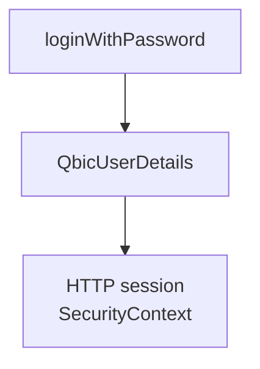

# Authentication flows — principal types and the ORCID link

**Last rewritten:** 2026-11-17, when ORCID stopped being a login (`AUTH-R-07`).

If you are looking for how a user gets *into* the application, read §1. If you are looking for what
happens to the ORCID iD on their account, read §2.

---

## 1. Getting in: one path, one principal type



That is the whole of it.

There used to be a second arrow — `loginWithOrcid` producing a `QbicOidcUser` (or a bare
`DefaultOidcUser` that could be turned into an account). Both are gone. `QbicOidcUser` was deleted along
with `OidcUserDetailsService` and the success handler that produced it, because a principal type that
only an ORCID assertion can create is a login path, whether or not the login page still offers it.

**Consequence to keep in mind when reading older code or documentation:** anything that mentions
`QbicOidcUser`, "login with ORCID", or `/register/oidc` describes a state that no longer exists.

### Why the second path had to go

The milestone's goal is that a password alone never yields a session. That statement is only meaningful
if the password is the *only* first factor. While `oauth2Login()` was configured, an ORCID assertion
produced a fully authenticated principal, so a second-factor check applied to the password path would
have left the provider path untouched — and the requirement's own "no account is exempt" clause
(`AUTH-R-01`) would have been false.

### The one identity that matters

`QbicUserDetails.getUsername()` returns the **QBiC user id**, not the email address and not the user
name. Spring Security ACLs key on that value, so every authorisation decision in the application follows
from it. It was also true of the deleted `QbicOidcUser`, which is why removing that class did not change
any permission outcome — but verify that claim if you touch ACL code, rather than trusting this note.

---

## 2. The ORCID link: an attribute, not a credential

### 2.1 What is stored

Two columns on `users`, and nothing else:

| Column | Example |
|---|---|
| `oidcId` | `0000-0002-1825-0097` |
| `oidcIssuer` | `https://orcid.org` (or `https://sandbox.orcid.org`) |

No access token, no refresh token, no id token. The link filter reads the iD from the provider's
userinfo response and **discards the token that made it readable**, so the application never becomes a
holder of ORCID credentials.

### 2.2 Linking

```mermaid
sequenceDiagram
    actor User
    participant App as "GET /link/orcid"
    participant Session as HTTP session
    participant ORCID
    participant CB as "GET /login/oauth2/code/orcid"
    participant Settings as "/settings/profile"

    User->>App: click "Connect ORCiD iD"
    App->>Session: pendingLinkUserId + returnTo
    App->>ORCID: redirect (authorization request)
    ORCID->>CB: code
    CB->>CB: token exchange (OAuth2AuthorizedClient)
    CB->>ORCID: userinfo with the access token
    ORCID-->>CB: sub = the bare iD
    CB->>CB: link(userId, iD, issuer); discard the token
    CB->>Session: outcome (an enum)
    CB->>Settings: redirect
    Settings->>Session: read + remove outcome
    Settings->>User: notification
```

Three properties of this design are load-bearing, and each has been broken once already:

1. **The session is the carrier for the pending link**, because the user leaves the site and comes back.
   It is not a general preference — it is forced by the provider round trip. The *outcome* also rides in
   the session, which is a convenience rather than a requirement, since the decision and the redirect
   happen in one request.
2. **The outcome is an enum, never a sentence.** An earlier version put the message text in
   `?error=1&reason=…`, which meant anyone could craft a URL that made the application render their words
   in a trusted notification on its own domain.
3. **The outcome lives in the servlet `HttpSession`, not in `VaadinSession`.** These are different
   attribute maps. Writing to one and reading from the other yields `null` silently, which is how a
   rejected link came to show the user nothing at all.

### 2.3 Unlinking

`clearOidcEntry()` on the aggregate, exposed through `OidcLinkService.unlink`. A confirmation dialog
precedes it, and the settings group re-renders in place.

Unlink is not a nicety. Its absence was a defect: a link could be written but never removed, so a wrong
iD — or a correct iD recorded against the wrong registry — was permanent without a database edit.

### 2.4 Relinking and conflicts

- Linking the iD the account **already holds** is a success (`ALREADY_LINKED`), not a conflict. The
  previous implementation answered "OpenID already in use" here, which made a stale link unrepairable.
- Linking an iD held by a **different account** is refused (`HELD_BY_ANOTHER_ACCOUNT`). The message names
  the way forward rather than dead-ending, because the user cannot fix it from their own session.
- The refusal does **not** disclose which account holds the iD. The iD is public researcher data; the
  mapping from it to a platform account is not.

### 2.5 One registry, and it is configured

`qbic.oidc.orcid.issuer` is written to `users.oidcIssuer` on every link, and it is **half of the link's
uniqueness key** — the same iD under two registries is two different links.

It has **no code default**. A missing value fails at startup, and startup also cross-checks it against
the registry the OAuth client actually talks to (derived from
`spring.security.oauth2.client.provider.orcid.authorization-uri`). This exists because a single
deployment came to hold both `https://orcid.org` and `https://sandbox.orcid.org` values on different
rows, and one user could not attach their iD because a stale row under the other registry still held it.

`qbic.external-service.person-search.orcid.issuer` is derived from the same key, so a searched
researcher and a linked account are rendered identically.

---

## 3. What the application must never do with an ORCID iD

| Not this | Why |
|---|---|
| Authenticate a user from it | `AUTH-R-01`: the second factor is applied to the password path, so there must be no other path |
| Create an account from it | That is what produced accounts with `encryptedPassword IS NULL` |
| Overwrite the local email from the ORCID record | The DM email is the authentication identifier and is verified; an ORCID email is an unverified attribute of a public record. Overwriting it would let whoever controls an ORCID record repoint an account to their own mailbox |
| Use it as an authorisation input | ACLs key on the QBiC user id |
| Use it as a second factor | ORCID's `amr` claim (`pwd`/`mfa`) is Member-API only, and ORCID cannot be mandated for all users |

The two emails are *expected* to differ and are never compared. We request `scope=openid` only, and
ORCID's supported claims do not include `email`, so the provider does not send one.

---

## 4. Where the code lives

| Concern | Package |
|---|---|
| Port (link / unlink / find) | `identity-api` → `OidcLinkService` |
| ORCID iD format | `identity-api` → `OrcidIds` |
| Outcome enum | `identity-api` → `OidcLinkOutcomeMessage` |
| Implementation | `identity` → `application/user/OidcLinkServiceImpl` |
| Start of the link | `datamanager-app` → `security/OidcLinkController` |
| Completion after the provider round trip | `datamanager-app` → `security/OidcLinkCompletionFilter` |
| Filter chain wiring | `datamanager-app` → `security/SecurityConfiguration` |
| Settings surface | `datamanager-app` → `views/account/UserProfileComponent` |

## 5. Guards

`OrcidIsNotALoginPathSpec` asserts the properties structurally — bytecode, not behaviour — because the
failure mode is a filter-chain configuration that no behavioural spec exercises. It was verified to fail
when `oauth2Login` is reinstated.

`OidcLinkSpec` pins link/unlink/relink semantics. `OidcLinkReturnPathSpec` pins the open-redirect
constraints. `OidcLinkOutcomeRenderingSpec` pins the notification contract, including which session store
is used.

Two defects in this area were found on a running build rather than by the suite, both in the same
notification path. When a flow ends in user-visible feedback, assert what the user sees — not that a
message key exists.
